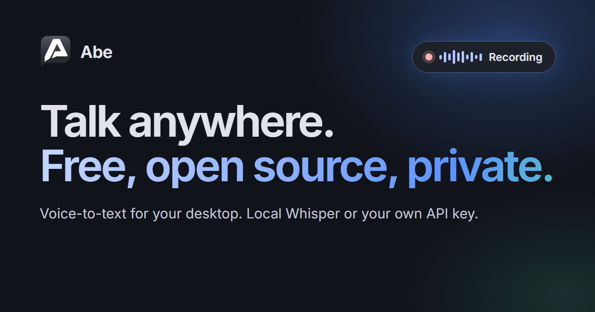

<div align="center">


# Abe

**Free, open-source voice-to-text for your desktop.**<br>
Hold a key, talk, and your words appear wherever you're typing.

[](LICENSE)
[](https://github.com/HardHeadHackerHead/honest-abe/releases/latest)


[**Download**](#download) · [**Website**](https://getabe.app) · [**Docs**](https://getabe.app/docs) · [**Get an API key**](https://getabe.app/docs/api-keys/groq) · [**Support Abe**](#support-abe)

<br>



</div>

<br>

Abe is a desktop dictation app. It has **no accounts, no subscription and no servers**. You choose how your speech gets transcribed:

- **Local:** Whisper runs on your own computer. It's free, works offline, and your audio never leaves your machine.
- **Your own API key:** your computer sends audio straight to Groq, OpenAI, or any OpenAI-compatible endpoint. It's fast on any hardware, and you pay the provider directly, usually a few cents per hour of talking.

## Why Abe

|  |  |
|---|---|
| 🎙️ **Dictate into any app** | One global hotkey works in your editor, browser, chat, email and terminal. Use push-to-talk, or press once to start and again to stop. |
| 🔒 **Private by design** | There are no Abe servers and no telemetry. Keys live in your OS keychain, and your history stays on your machine. |
| 💸 **Free, with no catch** | Local mode costs nothing. With your own key there's no markup, so you pay your provider's price. |
| ✨ **Voice Transform** | Select text, hold a key and say *"make this more formal"* or *"translate to Spanish"*. Abe replaces the selection with the result. |
| 📖 **Learns your words** | A personal dictionary fixes names and jargon that Whisper keeps getting wrong. |
| 🧩 **Open source** | Licensed AGPL-3.0. Read it, build it and improve it. |

## Choose your engine

|  | **Local** | **Groq** *(recommended cloud)* | **OpenAI** | **Custom** |
|---|---|---|---|---|
| Cost | Free | ~$0.04 per hour of audio | ~$0.27 per hour of audio | Your server |
| Works offline | ✅ | — | — | Depends |
| Audio leaves your PC | Never | Goes to Groq | Goes to OpenAI | Goes to your endpoint |
| Speed | Depends on your hardware | Very fast | Fast | Depends |
| Setup | One-time model download | [Get a key](https://getabe.app/docs/api-keys/groq) | [Get a key](https://getabe.app/docs/api-keys/openai) | [Base URL + model](https://getabe.app/docs/api-keys/custom) |

Prices are as of October 2026; see the [costs page](https://getabe.app/docs/costs) for current details. Voice Transform needs a chat model from Groq, OpenAI or a custom endpoint such as Ollama, even if you transcribe locally.

## Download

| Platform | Installer |
|---|---|
| **Windows** 10 / 11 (x64) | [`Abe-windows-x64-setup.exe`](https://github.com/HardHeadHackerHead/honest-abe/releases/latest/download/Abe-windows-x64-setup.exe) |
| **macOS** 10.15+ (Apple silicon) | [`Abe-macos-arm64.dmg`](https://github.com/HardHeadHackerHead/honest-abe/releases/latest/download/Abe-macos-arm64.dmg) |
| **macOS** 10.15+ (Intel) | [`Abe-macos-x64.dmg`](https://github.com/HardHeadHackerHead/honest-abe/releases/latest/download/Abe-macos-x64.dmg) |
| **Linux** | [Build and run from source](docs/linux.md). Includes X11 support and compositor shortcuts for Wayland. |

On macOS, allow **Microphone** and **Accessibility** access. Accessibility is what lets Abe paste into other apps.

## Quick start

1. **Open Abe.** The setup guide asks how you want to transcribe.
2. **Choose an engine.**
   - **Local (offline):** pick a model and wait for the one-time download. `base` is a good default, and `large-v3-turbo` is the most accurate. See the [model guide](https://getabe.app/docs/local-models).
   - **Use my own API key:** pick a provider, paste your key, then click **Save & test**. New to this? Follow the [step-by-step Groq guide](https://getabe.app/docs/api-keys/groq).
3. **Hold the hotkey and talk.** Let go, and the text appears where your cursor is.

### Default hotkeys

| Action | Windows / Linux | macOS |
|---|---|---|
| Dictate (hold to talk) | <kbd>Ctrl</kbd>+<kbd>Alt</kbd>+<kbd>Space</kbd> | <kbd>Ctrl</kbd>+<kbd>Option</kbd>+<kbd>Space</kbd> |
| Paste last transcription | <kbd>Ctrl</kbd>+<kbd>Alt</kbd>+<kbd>V</kbd> | <kbd>Ctrl</kbd>+<kbd>Option</kbd>+<kbd>V</kbd> |
| Transform selected text | <kbd>Ctrl</kbd>+<kbd>Alt</kbd>+<kbd>T</kbd> | <kbd>Ctrl</kbd>+<kbd>Option</kbd>+<kbd>T</kbd> |

You can change any of them, including to mouse buttons, in **Settings → Shortcuts**.

## Privacy

- **No Abe servers.** The app only talks to the services you pick.
- **Local mode stays on your device.** The only network request is the one-time model download from Hugging Face, and Abe checks it against a pinned SHA-256 hash.
- **Cloud mode goes directly to your provider**, under your account and their data policy. For Transform, the selected text is sent too.
- **API keys are stored in your OS keychain**: Windows Credential Manager, macOS Keychain or the Linux Secret Service. They're never kept in plain-text settings, and the UI never reads them back.
- **No telemetry or analytics.** History, stats and settings stay in local app storage.
- **Updates:** official builds check GitHub Releases and verify each update's signature before installing it. Builds from source leave the updater out.

> **About the global hotkey:** Abe watches only for its own key combinations, and it never logs or sends your keystrokes. Transform reads your selection by simulating <kbd>Ctrl</kbd>+<kbd>C</kbd>, then puts your clipboard back.

## Building from source

Every platform needs **Node.js 20+** and **Rust (stable)**. Local Whisper is compiled in, so you also need a C/C++ toolchain, **CMake** and **libclang**.

```bash
git clone https://github.com/HardHeadHackerHead/honest-abe.git
cd honest-abe
npm install
npm run tauri dev      # run in development
npm run tauri build    # installers in src-tauri/target/release/bundle/
```

<details>
<summary><b>Platform prerequisites</b></summary>

<br>

| Platform | Install |
|---|---|
| Windows | [Visual Studio 2022 Build Tools](https://visualstudio.microsoft.com/visual-cpp-build-tools/) with *Desktop development with C++*, [CMake](https://cmake.org/download/), [LLVM](https://github.com/llvm/llvm-project/releases) (for libclang). Windows 10/11 already include WebView2. |
| macOS | `xcode-select --install`, then `brew install cmake` |
| Linux (Debian/Ubuntu) | `sudo apt install libwebkit2gtk-4.1-dev libayatana-appindicator3-dev librsvg2-dev patchelf libssl-dev libasound2-dev libxdo-dev libx11-dev libxi-dev libxtst-dev libdbus-1-dev pkg-config cmake clang libclang-dev` |
| Linux (Arch) | `sudo pacman -S --needed base-devel webkit2gtk-4.1 libappindicator-gtk3 librsvg patchelf alsa-lib libx11 libxi libxtst dbus pkgconf cmake clang` |

For Linux session support, desktop shortcuts and troubleshooting, see [the Linux guide](docs/linux.md). Wayland uses compositor shortcuts rather than the built-in X11 hotkey listener.

If libclang isn't found, set `LIBCLANG_PATH` (for example `C:\Program Files\LLVM\bin`).

**Windows:** if the build fails with `'stdio.h' file not found` or `could not find any instance of Visual Studio`, the newest Visual Studio on the machine has no C++ toolset. Build from an *x64 Native Tools Command Prompt for VS 2022*, then run `cargo clean -p whisper-rs-sys` in `src-tauri` and build again.

</details>

<details>
<summary><b>Cargo features</b></summary>

<br>

| Feature | Default | What it does |
|---|---|---|
| `updater` | off | Auto-updater for the official release feed. Leave it off for your own builds and forks. |
| `metal` | off | GPU acceleration for local Whisper on Apple silicon |
| `vulkan`, `cuda` | off | GPU acceleration for local Whisper with Vulkan or CUDA |

Example: `npm run tauri build -- --features metal`

</details>

<details>
<summary><b>Checks and tests</b></summary>

<br>

```bash
npx tsc --noEmit        # type-check the UI
npm test                # Vitest unit tests
cd src-tauri
cargo clippy --all-targets -- -D warnings
cargo test
```

Official signed releases are built locally with the scripts in [`scripts/`](scripts/README.md).

</details>

<details>
<summary><b>Project layout</b></summary>

<br>

```text
.
├── src/                 React + TypeScript UI (Vite, Tailwind)
│   ├── components/      Settings, engine setup, overlay, onboarding
│   ├── hooks/           Recording, hotkeys, engine status
│   └── services/        Tauri command wrappers, local history and stats
├── src-tauri/           Rust backend (Tauri 2)
│   ├── src/engine/      Local Whisper, cloud providers, keychain storage
│   ├── src/audio.rs     Microphone capture and resampling
│   ├── capabilities/    Per-window permissions
│   └── tauri.conf.json
├── site/                getabe.app website (Astro + Starlight)
├── scripts/             Release, signing, licensing and icon scripts
└── .github/             Issue and pull request templates
```

</details>

## Contributing

Bug reports, fixes and ideas are welcome. Start with [CONTRIBUTING.md](CONTRIBUTING.md). Commits need a DCO sign-off (`git commit -s`), and everyone who takes part follows the [Code of Conduct](CODE_OF_CONDUCT.md). Please report security issues privately as described in [SECURITY.md](SECURITY.md).

## Support Abe

Abe is free, with no ads, accounts or upsells. If it saves you time, a donation helps cover code-signing certificates, the Apple developer fee and development time.

<a href="https://buy.stripe.com/dRm28q7VlgEa8KZ5Rq3Je00"></a>

## License

Abe is licensed under the [GNU Affero General Public License v3.0 or later](LICENSE). Third-party licenses are listed in [THIRD_PARTY_NOTICES.md](THIRD_PARTY_NOTICES.md). The Whisper models are released by OpenAI under the MIT license. Abe downloads them on demand, so they aren't bundled with the app.

"Abe" and the Abe logo are trademarks of Quads Lab. The AGPL covers the code, not the name or logo. If you distribute a fork, please rename it and use a different icon. See [TRADEMARKS.md](TRADEMARKS.md).
